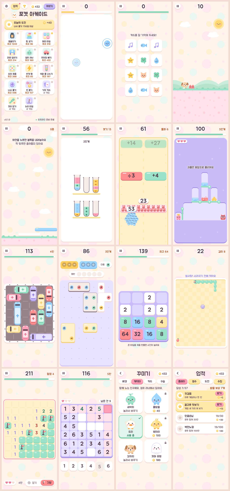

# 포켓 아케이드

온·오프라인에서 모두 즐길 수 있는 말랑한 파스텔 그림의 미니게임 웹앱(PWA)입니다.
한 번 접속해 두면 그 뒤로는 인터넷 없이 실행되고, 기록은 기기 안에 저장됩니다.
인터넷이 될 때는 닉네임으로 온라인 랭킹에 참여하고, 코드로 기록을 다른 기기에 옮길 수 있습니다(계정 없음).



## 지금 들어 있는 것

- **허브**: 한 줄에 세 개씩 놓인 게임 카드, 게임별 최고 기록, 코인. 카드의 별을 누르면 즐겨찾기에 들어가 앞쪽에 놓이고, 그다음은 최근에 한 게임부터 차례로 놓입니다. 화면이 짧아 게임이 다 들어가지 않으면 쪽으로 나뉘고, 아래 버튼이나 옆으로 밀기로 넘겨 봅니다.
- **오늘의 도전**: 날마다 게임 하나와 목표 점수가 정해지고, 넘기면 코인을 받습니다. 매일 이어서 달성하면 보너스가 붙습니다. 인터넷 없이 기기의 날짜만으로 정해집니다.
- **번개 탭**: 30초 동안 나타나는 구슬을 사라지기 전에 터치하는 게임
- **기억 카드**: 60초 동안 같은 그림 두 장을 찾아 짝을 맞추는 게임 (판을 깨면 카드가 12장, 16장, 20장으로 증가)
- **점프 러너**: 저절로 달리는 캐릭터를 화면을 눌러 뛰게 해서 장애물을 넘는 게임 (길게 누르면 높이 점프, 부딪히면 끝)
- **탑 쌓기**: 좌우로 오가는 블록을 화면을 눌러 내려놓아 높이 쌓는 게임 (어긋난 만큼 블록이 좁아지고, 딱 맞히면 줄지 않으며, 연속으로 딱 맞히면 다시 넓어짐. 하나도 걸치지 않으면 끝)
- **색깔 물 나누기**: 병을 누르고 부을 병을 눌러 물을 옮기며 같은 색끼리 한 병에 모으는 퍼즐 (단계가 오를수록 색이 늘고, 단계마다 정해진 붓기 횟수 안에 다 모아야 다음으로 넘어감. 모든 판은 풀 수 있게 나옴)
- **관문 달리기**: 저절로 달리는 무리를 좌우로 옮겨 더하기·곱하기 관문을 골라 수를 불리고, 길을 막은 적을 뚫고 나가는 게임 (적보다 수가 적으면 끝)
- **핀 뽑기**: 핀을 순서대로 뽑아 용암을 물로 식히고 보물을 받는 퍼즐 (보물이 타거나 괴물에게 닿거나 시간이 다 되면 하트를 잃고, 하트 세 개를 모두 잃으면 끝)
- **주차장 빼기**: 꽉 찬 주차장에서 앞이 뚫린 차부터 눌러 차례로 내보내는 퍼즐 (60초로 시작해 판을 비울 때마다 시간이 늘고, 막힌 차를 누르면 시간이 깎임)
- **나사 풀기**: 겹쳐 쌓인 판에 박힌 나사를 눌러 풀어 같은 색 상자에 세 개씩 모으는 퍼즐 (위 판에 가려진 나사는 풀 수 없고, 맞는 상자가 없는 나사는 쟁반에서 기다림. 쟁반이 가득 차서 더 둘 곳이 없으면 끝)
- **머지 타일**: 화면을 밀어 타일을 한쪽으로 모으고 같은 숫자끼리 합쳐 큰 숫자를 만드는 게임 (90초로 시작해 32 이상의 타일을 처음 만들 때마다 시간이 늘고, 꽉 막혀 더 밀 수 없으면 끝)
- **꼬리 잡기**: 저절로 기어가는 애벌레를 화면을 밀어 돌리며 먹이를 먹이는 게임 (먹을수록 몸이 길어지고 빨라지며, 벽이나 제 몸에 부딪히면 끝. 가끔 나오는 별사탕은 사라지기 전에 먹으면 큰 점수)
- **논리 타일**: 숫자 힌트를 보고 함정이 없는 칸만 골라 여는 퍼즐 (숫자는 둘레 여덟 칸에 숨은 함정의 수. 길게 누르거나 깃발 버튼으로 함정 자리를 표시하고, 함정을 밟으면 하트를 잃음. 하트 세 개나 시간이 다 떨어지면 끝. 모든 판은 찍지 않고 풀 수 있게 나옴)
- **숫자 퍼즐**: 가로줄, 세로줄, 상자마다 숫자가 한 번씩 들어가게 빈칸을 채우는 퍼즐 (4×4에서 시작해 6×6, 9×9로 커지고, 틀린 숫자를 두면 하트를 잃음. 하트 세 개나 시간이 다 떨어지면 끝. 모든 판은 찍지 않고 풀 수 있게 나옴)
- **등불지기**: 허브 맨 앞에 놓이는 대표 게임. 몰려오는 그림자 무리 사이를 끌어서 움직이며 10분을 버티는 서바이벌 (공격은 자동, 레벨이 오를 때마다 강화 셋 중 하나 선택, 무기는 7종 가운데 4개까지). 2분마다 중간 보스가 나오고(부하를 부르는 것, 돌진하는 것, 빛덩이를 쏘는 것 세 가지), 잡으면 받는 무기 강화권으로 무기를 한 단계 올리거나 5레벨 무기를 최종 진화형으로 바꿉니다. 10분에 마지막 보스가 나옵니다. 보스는 공격하기 전에 미리 알려 줍니다(돌진할 길이 바닥에 붉게 보이고, 쏘기 전에는 빛을 모읍니다). 캐릭터 셋(시작 무기와 타고난 특성이 다름)과 스테이지 둘(밤의 풀밭, 웅덩이에 빠지면 느려지는 안개 늪) 가운데 골라 시작하고, 오래 버틴 기록이 쌓이면 잠긴 것이 열립니다. 판이 끝나면 받는 불씨로 영구 강화 열한 가지를 사서 다음 판이 조금씩 쉬워집니다(레벨업 선택지를 다시 뽑는 것, 시작할 때 강화를 하나 더 고르는 것도 여기서 삽니다). 새벽을 맞으면 그 스테이지의 **깊은 밤**이 한 단계 열립니다(8단계까지). 단계가 깊을수록 적이 세지고 점수와 불씨가 더 붙어서, 완주한 뒤에도 기록을 더 올릴 수 있습니다. 준비 화면의 **도전 과제** 15개는 달성하면 눌러서 불씨를 받습니다. 일시정지하면 지금 빌드(무기와 패시브의 이름과 레벨, 무기마다 준 피해의 비중)가 보이고, 결과 화면에도 무기별 피해가 나옵니다. 화면 밖에 있는 보스는 가장자리의 화살표가 가리킵니다. 도중에 앱을 닫아도 이어서 할 수 있고, 하던 판이 있을 때 새로 시작하려면 한 번 더 눌러야 합니다.
- **꾸미기 상점**: 모은 코인으로 배경 무늬, 캐릭터(새싹이, 물방울, 오리, 병아리, 강아지, 꼬마 유령), 기억 카드 뒷면, 번개 탭 구슬을 사서 바꿉니다. 고른 캐릭터는 점프 러너에서 달리고 허브와 결과 화면에도 나옵니다. 겉모습만 바뀌고 게임 규칙은 그대로입니다.
- **업적**: 판 수, 최고 점수, 오늘의 도전, 꾸미기 수집으로 달성하는 목표 39개. 달성하면 업적 화면에서 눌러 코인을 받습니다. 업적이 생기기 전에 쌓은 기록도 인정됩니다.
- **온라인 랭킹**: 닉네임을 정하면 게임별 최고 점수가 랭킹에 올라갑니다(허브의 우승컵 버튼, 결과 화면의 랭킹 줄). 계정도 개인 정보도 없이 닉네임과 점수만 올립니다. 닉네임을 정하기 전에는 서버에 아무것도 보내지 않고, 인터넷이 없을 때 낸 기록은 다음에 연결될 때 올라갑니다. 랭킹 화면에서 닉네임을 바꾸거나 내 기록을 랭킹에서 뺄 수 있습니다.
- **다른 기기로 옮기기**: 설정에서 "코드 만들기"를 누르면 8글자 코드가 나오고, 15분 안에 다른 기기의 "코드 입력"에 넣으면 기록(코인, 꾸미기, 업적, 등불지기의 불씨와 강화, 하던 판, 닉네임)이 그 기기로 옮겨집니다.
- **세이브**: 기기 안(IndexedDB)에 자동 저장, 파일로 내보내기·가져오기(등불지기 진행 포함), 초기화
- **설정**: 효과음, 진동
- **오프라인**: 서비스 워커가 게임 파일을 모두 받아 두어 비행기 모드에서도 실행
- **공통 기반**: 일시정지(앱이 가려지면 자동), 결과 화면, 점수·시간 표시, 말랑한 UI 부품

## 실행

Node.js 22.12 이상이 필요합니다. CI와 배포는 `.nvmrc`에 적힌 버전을 씁니다.

```bash
npm install
npm run dev       # 개발 서버. 같은 와이파이의 휴대폰에서도 접속할 수 있습니다.
npm test          # 단위 테스트
npm run build     # 타입 검사 후 dist/ 에 빌드
npm run preview   # 빌드 결과 실행. 오프라인 동작은 여기서 확인합니다.
npm run server    # 랭킹과 기기 옮기기를 맡는 서버를 내 컴퓨터에서 실행 (포트 8787)
```

개발 서버에서는 서비스 워커가 꺼져 있습니다. 오프라인 동작을 보려면 `npm run build` 뒤에 `npm run preview`로 여세요.

랭킹과 기기 옮기기는 서버(`worker/`)가 있어야 동작합니다. 개발하면서 보려면 다른 터미널에서 `npm run server`를 켜 두세요. 개발 서버가 `/api/` 요청을 그쪽으로 넘깁니다. `npm run server`는 `dist/`도 함께 내려 주므로, `npm run build` 뒤에 `http://localhost:8787`을 열면 배포된 것과 같은 모양으로 확인할 수 있습니다. 서버를 켜지 않아도 게임은 그대로 되고, 랭킹 화면에는 연결할 수 없다는 안내만 나옵니다.

## 휴대폰에서 플레이하기

[Cloudflare Workers](https://workers.cloudflare.com/)가 이 저장소를 직접 읽어서 빌드하고, 빌드 결과물(`dist/`)과 작은 서버(`worker/`)를 함께 배포합니다. 저장소는 비공개여도 됩니다. 배포 설정은 `wrangler.jsonc`에 있습니다.

### 처음 한 번: 저장소 연결

1. [Cloudflare 대시보드](https://dash.cloudflare.com/)에 가입하거나 로그인한 뒤 **Workers & Pages**에서 **Create application**을 누릅니다.
2. GitHub 계정을 연결하고 이 저장소를 고릅니다. 저장소가 목록에 없으면 GitHub의 [설치된 앱 설정](https://github.com/settings/installations)에서 **Cloudflare Workers and Pages**의 **Configure**를 눌러 이 저장소에 접근할 권한을 줍니다.
3. **Set up your application** 화면에 아래 값을 넣고 **Deploy**를 누릅니다.

| 항목 | 값 |
| --- | --- |
| Project name | `minigame` |
| Build command | `npm run build` |
| Deploy command | `npx wrangler deploy` |

Project name은 `wrangler.jsonc`의 `name`과 같아야 합니다. 다르면 빌드가 실패하므로, 이름을 바꾸려면 두 곳을 함께 바꿉니다.

배포가 끝나면 `https://minigame.<계정 이름>.workers.dev` 꼴의 주소가 나옵니다. 그 뒤로는 `main`에 합쳐질 때마다 자동으로 다시 배포됩니다. 빌드에 쓰는 Node.js 버전은 `.nvmrc`를 따릅니다.

`main`이 아닌 브랜치를 올리면 Cloudflare가 미리보기를 따로 만들고, PR에 미리보기 주소를 댓글로 남깁니다. 합치기 전에 휴대폰에서 먼저 해 볼 수 있습니다. 이 기능은 `wrangler.jsonc`의 `previews` 블록이 있어야 동작합니다.

### 합쳤는데 배포되지 않을 때

`main`에 합친 뒤 몇 분이 지나도 배포된 주소가 예전 그대로라면, 먼저 Cloudflare가 빌드를 했는지 봅니다. 대시보드에서 **Workers & Pages**, `minigame`, **Deployments** 순서로 들어가 맨 아래의 **View Build History**를 엽니다.

- **합친 커밋의 빌드가 실패로 나와 있을 때**: 그 빌드를 열어 로그 끝의 오류를 봅니다. 고칠 것이 없는 일시적인 실패라면 **Retry build**로 다시 돌립니다.
- **합친 커밋의 빌드가 목록에 아예 없을 때**: Cloudflare가 그 푸시를 놓친 것입니다(GitHub의 커밋 옆에도 검사 표시가 없습니다). `main`에 다음 커밋이 들어가면 그때 최신 상태로 빌드합니다. 새 커밋 없이 바로 돌리려면 **Settings**, **Builds**, **Deploy Hooks**에서 브랜치를 `main`으로 고른 훅을 만들고, 나온 주소로 `curl -X POST "<훅 주소>"`를 보냅니다. 훅 주소는 아는 사람 누구나 빌드를 시작할 수 있으므로 비밀번호처럼 다룹니다.
- **빌드가 계속 시작되지 않을 때**: GitHub의 [설치된 앱 설정](https://github.com/settings/installations)에서 **Cloudflare Workers and Pages**가 이 저장소에 접근할 수 있는지 확인합니다.

### 설치

1. 휴대폰 브라우저에서 배포된 주소를 열고 메뉴에서 **홈 화면에 추가**를 누르면 앱처럼 설치됩니다.
2. 허브 오른쪽 아래에 "오프라인 준비 완료"가 보이면 비행기 모드에서도 실행됩니다.

iOS Safari는 홈 화면에 추가하지 않고 오래 쓰지 않으면 저장 데이터를 지울 수 있습니다. 기록이 아깝다면 홈 화면에 추가하거나 설정의 "내보내기"로 백업해 두세요.

## 온라인 기능과 서버

게임 파일은 Cloudflare가 그대로 내려 주고, `/api/`로 시작하는 요청만 `worker/`의 서버 코드가 받습니다. 저장은 Durable Object 하나에 딸린 SQLite에 합니다. 따로 만들 것은 없고, `wrangler.jsonc`에 적힌 대로 배포할 때 저절로 생깁니다.

| 요청 | 하는 일 |
| --- | --- |
| `GET /api/rank/<게임 id>?me=<기기 id>` | 그 게임의 랭킹 위쪽 30줄과 내 순위 |
| `POST /api/rank` | 닉네임과 게임별 최고 점수 올리기(더 낮은 점수는 무시) |
| `DELETE /api/rank` | 내 기록을 모든 랭킹에서 지우기 |
| `POST /api/transfer` | 세이브를 15분 동안 맡기고 옮기기 코드 받기 |
| `POST /api/transfer/take` | 옮기기 코드로 세이브 받기 |

- **받는 정보**: 닉네임, 점수, 앱이 무작위로 만든 기기 id, 옮기려고 맡긴 세이브뿐입니다. 계정, 이메일, 위치는 받지 않습니다. 접속 주소(IP)는 요청 횟수를 세는 데만 쓰고 저장하지 않습니다. 기기 id는 랭킹을 보는 다른 사람에게 나가지 않습니다.
- **요금**: Cloudflare 무료 요금제 안에서 돌아갑니다. 무료 한도(하루 요청 10만 번, 저장 5GB 등)를 넘으면 요금이 붙는 것이 아니라 그날 남은 시간 동안 요청이 실패하고, 앱은 "지금은 서버가 쉬고 있어요"라고 알립니다. 게임은 그대로 됩니다.
- **막아 둔 것**: 닉네임은 2~10자의 글자와 숫자만, 점수는 1~999,999의 정수만 받습니다. 한곳에서 너무 자주 오는 요청, 새 이름을 마구 올리는 것, 옮기기 코드를 마구 넣어 보는 것은 횟수를 세어 잠깐 막습니다(`worker/limiter.ts`).
- **막지 못하는 것**: 점수는 기기에서 계산해 보내므로, 마음먹고 요청을 꾸며 보내는 것은 걸러 내지 못합니다. 닉네임의 욕설도 걸러 내지 않습니다. 친구끼리 겨루는 용도에 맞춘 구조입니다.
- **미리보기**: `main`이 아닌 브랜치의 미리보기는 저장소가 따로 생겨서, 거기서 올린 점수는 실제 랭킹에 섞이지 않습니다.

## 구조

```
worker/                서버(Cloudflare Workers): 랭킹과 기기 옮기기
  index.ts             /api/ 요청만 받고 나머지는 게임 파일로 넘긴다
  api.ts               요청을 읽고 값을 확인해서 답을 만든다
  service.ts           요청 한도를 확인한 뒤 저장소에 넣고 꺼내는 규칙
  board-db.ts          랭킹과 옮기기 코드의 SQL
  board.ts             위의 것을 Durable Object(SQLite)에 얹는다
  limiter.ts           같은 곳에서 너무 자주 오는 요청 걸러 내기
src/
  main.ts              앱 시작: 글꼴·세이브를 불러오고 Phaser 게임을 만든다
  config.ts            화면 크기, 색(THEME), 씬 이름
  art/                 그림과 텍스처 생성. 이미지 파일 없이 모두 코드로 그린다
    vector.ts          캐릭터, 아이콘, 카드, 구슬, 배경을 캔버스 곡선으로 그리기
    cosmetics.ts       꾸미기의 색과 무늬
    sprites.ts         픽셀 스프라이트(문자열 데이터). 같은 이름의 벡터 그림이 없을 때만 쓰인다
  core/                모든 게임이 같이 쓰는 공통 모듈
    save.ts            세이브 데이터 모양과 순수 함수
    bundle.ts          이 기기에 저장된 것 전부를 한 묶음으로 내보내고 가져오기 (파일 백업, 기기 옮기기)
    dialog.ts          글자를 입력받는 작은 창 (닉네임, 옮기기 코드). 캔버스 밖 DOM에 띄운다
    daily.ts           오늘의 도전: 날짜로 게임과 목표 정하기, 연속 달성 계산
    shop.ts            꾸미기 상점: 파는 것과 가격, 사기와 바꿔 끼우기
    achievements.ts    업적: 목록, 달성 조건, 보상 받기
    paging.ts          긴 목록을 쪽으로 나누는 계산 (허브, 업적 화면)
    swipe.ts           손가락이 움직인 거리로 네 방향 밀기 판정 (머지 타일, 꼬리 잡기)
    hidpi.ts           논리 240px 화면을 기기 해상도에 맞춰 또렷하게 그리기
    store.ts           IndexedDB 저장소
    sfx.ts             Web Audio로 만드는 칩튠 효과음
    ui.ts              글자, 패널, 버튼, 쪽 넘김 줄, 씬 전환
    pwa.ts             서비스 워커 등록과 오프라인 상태
  online/              온라인 기능에서 앱이 쓰는 부분
    protocol.ts        앱과 서버가 함께 쓰는 약속: 닉네임·점수·코드 규칙, 주고받는 모양
    profile.ts         닉네임과 "서버에 어디까지 올렸는지" (세이브에 들어간다)
    api.ts             서버 부르기. 실패해도 예외 없이 이유만 돌려준다
    sync.ts            올리지 못한 최고 점수 올리기
    online.ts          화면이 쓰는 창구: 랭킹 불러오기, 닉네임, 옮기기 코드
  scenes/              허브, 랭킹, 상점, 업적, 설정, 일시정지, 결과, 미니게임 공통 바탕과 HUD
  games/
    registry.ts        게임 목록과 허브에 놓는 순서
    lightning-tap/     번개 탭 (rules.ts에 난이도와 점수 규칙)
    memory-cards/      기억 카드 (rules.ts에 판 크기, 점수, 카드 배치)
    jump-runner/       점프 러너 (rules.ts에 점프, 속도, 장애물 배치, 점수)
    stack-tower/       탑 쌓기 (rules.ts에 블록 속도, 판정, 점수)
    color-sort/        색깔 물 나누기 (rules.ts에 붓기 규칙, 판 만들기와 풀이, 점수)
    gate-run/          관문 달리기 (rules.ts에 관문과 적의 수, 속도, 점수)
    pin-pull/          핀 뽑기 (rules.ts에 떨어지고 섞이는 규칙, 판 만들기와 풀이, 점수)
    parking-out/       주차장 빼기 (rules.ts에 차의 움직임, 판 만들기와 풀이, 시간과 점수)
    screw-sort/        나사 풀기 (rules.ts에 판과 나사, 상자와 쟁반, 판 만들기, 점수)
    merge-tiles/       머지 타일 (rules.ts에 밀기와 합치기, 새 타일, 시간과 점수)
    tail-chase/        꼬리 잡기 (rules.ts에 움직임과 속도, 먹이와 별사탕, 점수)
    logic-tiles/       논리 타일 (rules.ts에 열기와 깃발, 판 만들기와 풀이, 시간과 점수)
    number-puzzle/     숫자 퍼즐 (rules.ts에 줄과 상자, 판 만들기와 풀이, 시간과 점수)
    lantern-keeper/    등불지기 (아래 "등불지기 구조" 참고)
scripts/gen-icons.mjs  앱 아이콘을 코드로 생성
```

이미지와 음원 파일은 없습니다. 스프라이트는 `src/art/sprites.ts`의 문자열로, 효과음은 오실레이터로 만들기 때문에 용량이 거의 들지 않고 오프라인에서도 그대로 동작합니다.

## 미니게임 추가하기

1. `src/games/<게임 이름>/`에 `MiniGameScene`을 상속한 씬을 만듭니다. `create()` 첫머리에서 `beginMiniGame()`을, 게임이 끝나면 `finishMiniGame(점수, 통계)`를 부르면 일시정지·기록 저장·결과 화면이 따라옵니다. 끝나는 장면을 길게 보여 주고 싶으면 세 번째 값으로 결과 화면이 뜰 때까지의 시간(ms)을 주고, 끝맺음 소리를 따로 내려면 `playFinishSound()`를 바꿔 씁니다. 일시정지 화면에 게임만의 내용을 덧붙이려면 `pauseExtra()`를 바꿔 쓰고, 결과 화면의 기록 아래에 아이콘 한 줄을 덧붙이려면 `finishMiniGame`의 네 번째 값으로 넘깁니다(등불지기가 지금 빌드와 무기별 피해를 이렇게 보여 줍니다).
2. 점수와 남은 시간은 `src/scenes/GameHud.ts`의 `GameHud`로 그리면 다른 게임과 같은 모양이 됩니다.
3. `src/config.ts`의 `SCENE`에 씬 이름을 넣고 `src/main.ts`의 씬 목록에 등록합니다.
4. `src/games/registry.ts`에 게임 정보를 추가하면 허브에 카드가 생깁니다. 같이 적는 `dailyTargets`(쉬움, 보통, 어려움 순서의 목표 점수 세 개)는 오늘의 도전에 쓰입니다. 게임이 늘어 허브 한 화면에 다 들어가지 않으면 목록이 저절로 쪽으로 나뉩니다.
5. 그 게임의 점수 업적을 두려면 `src/core/achievements.ts`에 한두 줄을 넣습니다.
6. `src/online/protocol.ts`의 `RANKED_GAMES`에 게임 id를 넣으면 온라인 랭킹이 생깁니다. 빠뜨리면 테스트가 알려 줍니다.

규칙과 난이도는 `rules.ts`처럼 화면과 분리된 순수 함수로 두면 숫자만 바꿔 밸런스를 잡을 수 있고 테스트하기도 쉽습니다.

화면을 그릴 때 알아 둘 것:

- 좌표와 크기는 모두 논리 픽셀(가로 240)로 씁니다. 기기 해상도에 맞춘 확대는 `core/hidpi.ts`가 카메라로 처리하고, `this.scale.width`와 `height`도 논리 크기를 돌려줍니다.
- 터치 위치는 `pointer.x`, `pointer.y`가 아니라 `pointer.worldX`, `pointer.worldY`로 읽습니다.
- 색은 `config.ts`의 `THEME`(숫자)과 `THEME_CSS`(글자색)를 쓰고, 글자는 `core/ui.ts`의 `addText`로 씁니다. 게임 화면 위에 뜨는 글자는 `stroke` 옵션으로 흰 테두리를 두르면 묻히지 않습니다.
- 그림은 `src/art/vector.ts`에 캔버스 곡선으로 그려 등록합니다. 픽셀 스프라이트를 따로 쓰는 게임은 그 텍스처에만 `NEAREST` 필터를 겁니다.

## 등불지기 구조

다른 미니게임보다 크기 때문에 `src/games/lantern-keeper/` 안에서 역할을 나눴습니다. 그림과 세이브도 이 폴더 안에 따로 있어서 공용 코드(`art/`, `core/save.ts`)를 건드리지 않습니다.

| 파일 | 맡은 일 |
| --- | --- |
| `data.ts` | 적, 무기, 패시브, 영구 강화, 캐릭터, 스테이지의 이름과 숫자. 밸런스는 여기와 `rules.ts`만 고치면 됩니다. 스테이지를 늘릴 때는 `STAGES`에 등장표와 보스 차례를 한 묶음 넣습니다. |
| `rules.ts` | 난이도 곡선, 깊은 밤 단계의 배율(`depthRules`), 무기 성능, 레벨업 선택지, 점수와 불씨 계산 (순수 함수) |
| `sim.ts` | 한 판의 시뮬레이션. 화면 없이 돌아가고, 상태가 평범한 데이터라 그대로 저장해 이어하기에 씁니다. 적끼리의 충돌은 격자로 나눠 계산합니다. 보스의 행동(부르기, 돌진, 쏘기)과 공격 전의 뜸(돌진 방향이 굳는 때, 빛을 모으는 시간)도 여기 있습니다. |
| `terrain.ts` | 안개 늪의 웅덩이. 따로 저장하지 않고 판의 씨앗과 좌표로 그때그때 계산합니다. |
| `bot.ts` | 자동 플레이. 테스트에서 "가만히 서 있으면 오래 못 버틴다" 같은 밸런스를 숫자로 확인합니다. 캐릭터와 스테이지를 바꿔 가며 돌릴 수 있습니다. |
| `meta.ts` | 불씨와 영구 강화, 고른 캐릭터와 스테이지, 스테이지마다 열린 깊은 밤 단계, 쌓인 기록과 받은 도전 과제 보상, 진행 중인 판의 저장 (허브 세이브와 별도의 IndexedDB) |
| `challenges.ts` | 도전 과제 목록과, 판이 끝날 때마다 쌓는 기록(쓰러뜨린 수, 진화시킨 무기, 새벽을 맞은 캐릭터와 스테이지, 가장 깊은 단계). 과제를 늘릴 때는 `CHALLENGES`에 한 줄 넣습니다. |
| `art.ts` | 스프라이트 문자열과 효과 색. 그림체를 바꿀 때는 이 파일만 고칩니다. |
| `icons.ts` | 강화 선택 카드에 붙는 아이콘 22개(무기 7종과 진화형, 패시브, 회복, 불씨). 안쪽 색만 그리면 검은 테두리는 자동으로 둘러집니다. |
| `view.ts` | 시뮬레이션 상태를 화면에 그리기 (스프라이트 돌려쓰기, 어둠 덮개, 보스의 공격 예고, 화면 밖 보스를 가리키는 화살표) |
| `effects.ts` | 화면 전체에 덮는 연출: 맞았을 때의 붉은 번쩍임, 체력이 낮을 때 붉어지는 가장자리, 흰 번쩍임, 판이 끝날 때의 새벽빛과 어둠. 화면 흔들기도 여기를 거칩니다(카메라 배율을 감안해 세기를 맞춥니다). |
| `sound.ts` | 이 게임의 효과음. 음 하나하나를 값으로 적어 두었고, 빛 조각을 이어서 주우면 음이 올라가는 것과 몰려 나는 소리의 간격도 여기서 정합니다. 실제 소리는 `core/sfx.ts`의 `tone`으로 냅니다. |
| `hud.ts` | 플레이 중 화면 위쪽의 정보: 체력(하트와 숫자, 막대), 경험치, 시간, 든 무기와 패시브의 아이콘 칸. 캐릭터 아래의 작은 체력 막대도 여기서 그립니다. |
| `joystick.ts`, `levelup.ts` | 조작, 레벨업과 무기 강화권 선택 화면 |
| `build.ts`, `pauseinfo.ts` | 지금 빌드를 보여 주기 좋게 정리한 것(이름, 레벨, 무기마다 준 피해의 몫)과, 그것을 일시정지 화면에 그리는 것. 결과 화면의 "무기별 피해"도 `build.ts`를 씁니다. |
| `lobby.ts` | 준비 화면. 캐릭터와 스테이지, 깊은 밤 단계를 고르는 쪽, 영구 강화를 사는 쪽, 도전 과제 보상을 받는 쪽으로 나뉩니다. 목록이 화면보다 길면 쪽을 넘깁니다. |
| `LanternKeeperScene.ts` | 위의 것들을 잇는 씬 |

지금 들어 있는 것은 무기 7종(저마다 진화형 1종), 패시브 6종, 캐릭터 3명, 스테이지 2개(스테이지마다 적 4종과 마지막 보스 1종), 중간 보스 3종, 영구 강화 11종, 깊은 밤 8단계, 도전 과제 15개입니다. 캐릭터는 최고 기록 2분과 6분에, 안개 늪은 4분에 열립니다.

깊은 밤은 한 단계마다 적의 체력 +30%(보스 +35%), 피해 +15%, 속도 +1.5%, 나오는 수 +5%이고 점수는 +50%, 불씨는 +25% 붙습니다. 마지막 보스가 나온 뒤에 쓰러뜨린 적은 점수와 불씨에 세지 않습니다(보스를 남겨 두고 버티는 것을 막기 위해서입니다). 한 판에 받는 코인은 150개까지입니다.

## 꾸미기 추가하기

1. `src/core/shop.ts`의 `CATALOG`에 id, 자리(배경·캐릭터·카드·구슬), 이름, 가격을 한 줄 넣습니다.
2. `src/art/cosmetics.ts`에 같은 id로 색과 무늬를 적습니다. 둘이 어긋나면 테스트가 알려 줍니다.
3. 캐릭터를 새로 만들 때는 `src/art/vector.ts`의 `CHARACTERS`에 그리는 함수를 더합니다(달리기 두 장, 점프, 부딪힘, 서 있기, 기뻐하기를 한 함수가 자세만 바꿔 그립니다).

텍스처는 시작할 때 자동으로 만들어지고 상점에도 바로 나옵니다.

## 업적 추가하기

`src/core/achievements.ts`의 `ACHIEVEMENTS`에 한 줄을 넣으면 업적 화면에 나옵니다. 달성 여부는 세이브에 이미 있는 기록(판 수, 최고 점수, 오늘의 도전, 꾸미기)에서 계산하므로, 새 조건이 필요하면 같은 파일의 `AchievementStats`와 `statsOf`에 숫자를 더합니다. 한 화면에 다 들어가지 않는 탭은 저절로 쪽으로 나뉩니다.

## 기술

| 항목 | 선택 |
| --- | --- |
| 엔진 | Phaser 4 |
| 빌드 | Vite + TypeScript |
| 오프라인 | vite-plugin-pwa (Workbox 사전 캐시) |
| 저장 | IndexedDB (idb-keyval) |
| 서버 | Cloudflare Workers + Durable Object(SQLite). 랭킹과 기기 옮기기에만 쓴다 |
| 논리 해상도 | 가로 240px 고정, 세로는 화면 비율에 따라 400~560px. 실제 캔버스는 기기 화소에 맞춰 2~4배로 그림 |
| 배포 | Cloudflare Workers (Git 연결): 정적 파일과 서버 코드를 함께 |

## 크레딧

- 글꼴: [주아(Jua)](https://fonts.google.com/specimen/Jua) © 우아한형제들, SIL Open Font License 1.1 (`public/licenses/Jua-OFL.txt`)
- 그림: 모두 이 저장소의 코드로 그린 것입니다
- 엔진: [Phaser](https://phaser.io) (MIT)
